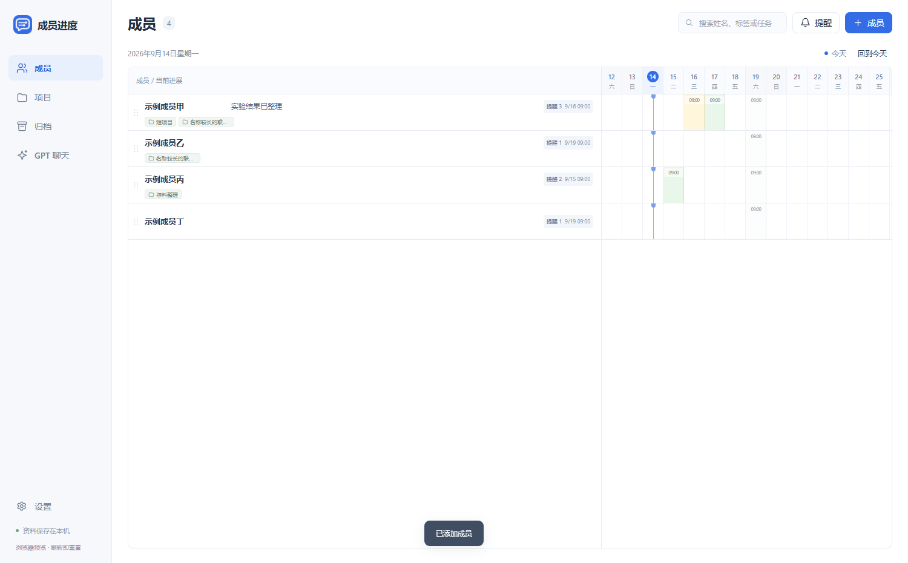
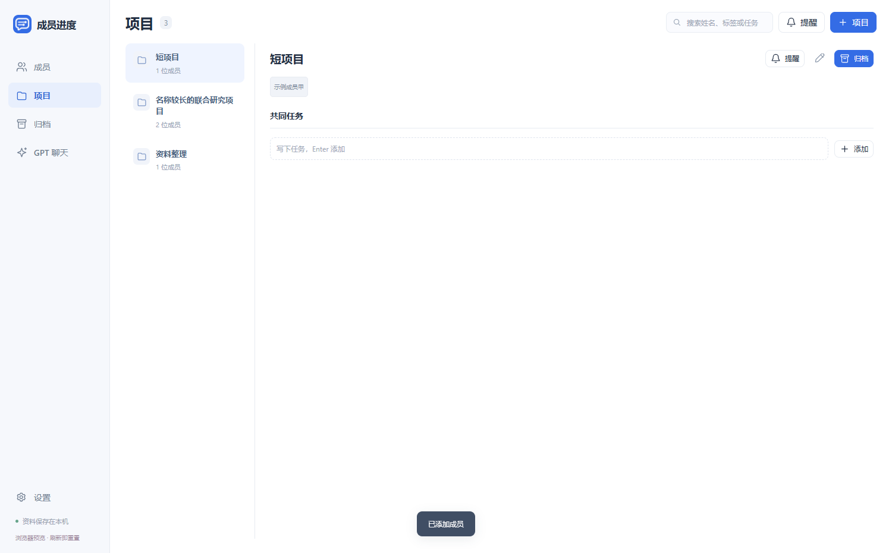

# 成员进度 · Member Progress


用于跟进成员与项目进度的 Windows 本地桌面应用。记一条进展、拖动任务日期或勾选完成，软件负责保存归档、生成摘要和到点提醒。

当前版本：**1.0.15**。不需要应用账号，首次打开为空白列表。

## 功能

- **成员总览**：姓名、可选年级与 meta 标签、bio；当前进展可直接编辑，成员可拖动排序。
- **甘特任务**：拖动日期创建任务、移动与调整期限，拖动分隔线调整左右比例，Ctrl＋滚轮调整甘特图日期宽度，一键完成或提交归档；时间不冲突的任务共用一排。
- **追加式归档**：发送文本、文件并生成摘要；可删除单条消息并撤销。原生 Codex 按需分析原附件、图片和相关完整历史。
- **项目协作**：按成员组成项目，共享任务与归档，成员行显示参与项目。
- **提醒**：全局、成员、项目提醒及每天、每周、每月、间隔重复；默认取消本次，整个提醒单独开关；甘特图标注，静音 Windows 通知。
- **GPT 聊天**：自主查询全库成员、任务、日程、归档与文件，按需搜索微信原文及本地向量索引；引用作为重点线索；设置当前用户后自然语言创建个人提醒、日期任务，支持聊天附件、按指令归档、流式工作过程、真实上下文用量、原生连续会话及清空撤销。
- **微信只读插件**：选择本机好友或群，完整导入并增量同步；独立聊天与文件库、图片解码与预览、BGE-M3 FP32 相似度检索、归档/GPT 原文引用、成员关联自动归档及遗漏提醒单卡建议。微信页展示后台索引阶段、实际百分比和当前处理对象；设置可调整自动同步间隔，微信资料单独导出。
- **本地资料**：自动保存、附件复制、完整备份与恢复；密钥由 Windows 加密保存。

## Android 手机端

手机端与 Windows 共用成员、任务、提醒、归档和 GPT 会话。成员页可横向滑动或点击切换到甘特图；任务和提醒使用现有 Windows 规则。手机只保留轻量编辑、文字归档及聊天，设置与完整资料仍在电脑管理。

Windows 在 **设置 → 手机连接** 开启访问并设置密码，可配置已有 frps；Windows 内置的是 frpc。手机首次输入地址和密码后记住登录。连接采用 HTTP，密码按个人使用要求明文保存在电脑；连接设置、设备令牌和 frp 口令不进入 Git 或发行包。

手机后台采用省电同步，已缓存提醒由 Android 系统通知；电脑关闭后无法提交修改和使用 GPT。详细操作与通知边界见 [手机连接说明](docs/mobile.md)，Android 源码与构建方法见 [mobile/android](mobile/android/README.md)。

## 界面

以下为虚构成员的界面预览，应用不会预置这些记录。





## 从源码运行

在 **Windows x64** 上安装 .NET 8 SDK 和 Microsoft Edge WebView2 Runtime，然后在仓库根目录执行：

```powershell
powershell -ExecutionPolicy Bypass -File scripts/prepare-frp.ps1
powershell -ExecutionPolicy Bypass -File scripts/prepare-embedding.ps1
# 读取器构建还需 Go（纯 Go 构建，无需 C 工具链），参见 wechat-reader/README.md
powershell -ExecutionPolicy Bypass -File wechat-reader/build.ps1
dotnet publish app/StudentProgress.csproj -c Release -r win-x64 --self-contained false -o artifacts/portable
.\artifacts\portable\StudentProgress.exe
```

前端是原生 HTML/CSS/JavaScript，无需 Node 或前端构建步骤。发布结果依赖 .NET 8 Desktop Runtime；完整 .NET 8 SDK 已提供相应开发与运行支持。其他电脑运行时需要 .NET 8 Desktop Runtime 和 WebView2。

源码仓库不存放 Codex CLI 二进制。首次从源码启动后，在 **设置 → GPT 聊天内核 → 更新内核** 下载官方稳定版；应用会校验 SHA512 后启用。自动更新默认关闭。已交付便携版随附的初始版本为 **0.154.0**，对应版本及完整性信息保存在 `app/runtime/codex/bundled.json`。

GPT 摘要和聊天仅使用 Responses API，在设置中配置可用的接口、模型与密钥。不开启 GPT 也可管理成员、任务、归档与提醒；使用 GPT 时，所选上下文会发送到配置的接口。

资料默认保存在可执行文件旁的 `Data` 目录。开发时可使用独立目录：

```powershell
.\artifacts\portable\StudentProgress.exe --data-dir .\artifacts\dev-data
```

## 代码结构

| 路径 | 内容 |
| --- | --- |
| `app/AppService*.cs` | 成员、项目、任务、归档、提醒、GPT 摘要和备份 |
| `app/MainForm.cs` | WebView2 宿主及前后端消息桥接 |
| `app/Notifications.cs` | Windows 静音通知及点击唤起 |
| `app/Assistant/` | 独立 GPT 聊天、Codex CLI 调用及更新模块 |
| `app/web/` | 电脑页面、样式、甘特图和聊天界面 |
| `app/web/mobile/` | 随 Windows 更新的手机页面 |
| `app/WeChat/` | 独立微信库、同步、原件引用、相似度检索及提醒建议 |
| `wechat-reader/` | Windows 微信数据库只读适配器及固定来源记录 |
| `app/Remote/` | 手机 HTTP 接口、连接设置与 frpc 管理 |
| `mobile/android/` | Android 外壳、登录及静音定时提醒 |
| `app/*Checks.cs` | 使用隔离目录的定向检查 |

界面使用“成员”，内部 `StudentProgress`、`student` 数据键和接口名保留，以兼容已有资料。

[微信模块说明](docs/wechat.md) · [使用说明](docs/usage.md) · [设计方案](docs/design.md) · [聊天模块说明](app/Assistant/README.md)

## 检查

v15 定向检查在独立空目录运行，不调用 GPT、不读取实际微信：

```powershell
Start-Process .\artifacts\portable\StudentProgress.exe -ArgumentList '--v15-test --data-dir artifacts/checks/v15' -Wait
```

结果写入该目录的 `v15-result.json`，覆盖微信进度/间隔、聊天附件备份恢复、原生工具创建与幂等、上下文统计。`--v15-live-test` 是显式启用的单次真实 Codex 合成资料联调，不能作为默认检查自动执行。

仓库仅保存源码、文档与选定的图片；个人资料、API 密钥、编译缓存、Codex 二进制及本机交付包均被忽略。
